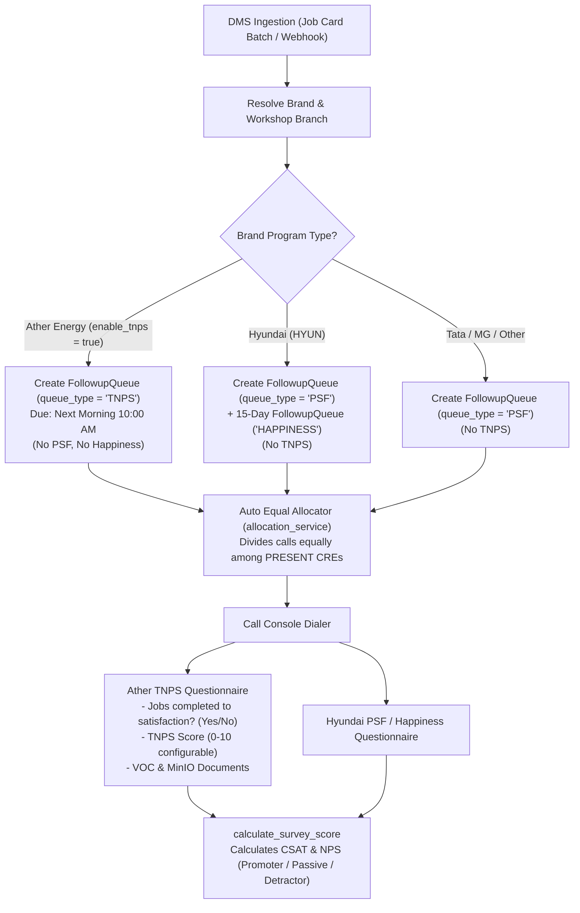

# TNPS Model Correction: Ather Energy PSF Programme

**Date:** 10 November 2026  
**Status:** Approved & Implemented  
**Reference Task:** Correct the TNPS model (TNPS = Ather brand's PSF programme)

---

## 1. Executive Summary & Root Cause Analysis

### 1.1 The Initial Misconception
In earlier iterations of the system architecture, "TNPS" (Transactional Net Promoter Score) was assumed to be a generic, dealership-wide secondary survey scheduled across all OEM brands (e.g., T+7 days after a primary PSF call).

### 1.2 The Empirical Evidence & Correction
Detailed analysis of the dealership legacy DMS data, historical spreadsheets, and operational dashboards proved this assumption was incorrect:
1. **Brand Exclusivity**: The dashboard "TNPS Calls" widget lists **only Ather Energy workshop branches** (e.g., *ATHER BANGALORE*, *ATHER ENERGY BELGAUM*, *ATHER ENERGY HUBBALLI*, *ATHER ENERGY SIRSI*).
2. **Column Ownership**: In the legacy 113-column master spreadsheet:
   - Columns 89–94 (`TNPS Followed By`, `TNPS Followed Timestamp`, `TNPS Call Status`, `TNPS VOC`, `TNPS Ratings`, `Document (TNPS)`) plus Column 76 (`Where all the jobs requested by you done up to your satisfaction?`) and Column 77 (`Ather Docs`) belong exclusively to the **Ather Energy** post-service follow-up process.
3. **Program Nature**: In this dealership network, **"TNPS" is the official manufacturer brand name for the Post Service Follow-up (PSF) programme for Ather Energy vehicles**, analogous to how Hyundai calls its initial survey "PSF" and its 15-day OEM survey "Happiness Calling".
4. **No Delayed Second Call**: Ather TNPS is created immediately from the job card upon DMS import, allocated equally among present CREs on Day 1 (due the next morning at 10:00 AM), dialed from the Call Console, and subject to the standard max-attempts and complaint escalation lifecycle. It is NOT a delayed second-stage call.
5. **The Hyundai "TNPS Date" Anomaly**: In the legacy Hyundai import files, a column named "TNPS Date" was populated (28 rows having `09-04-2026` and 1 row having `07-07-2026`). Its business meaning in Hyundai's DMS is unknown. It must NOT trigger scheduling logic; instead, it is safely retained as a raw legacy audit field (`job_cards.legacy_tnps_date`).

---

## 2. Comprehensive Audit of Impacted Files

The following components were built on the erroneous assumption and are audited below:

| Component | File Path | Previous Wrong Implementation | Correction Implemented |
| :--- | :--- | :--- | :--- |
| **Database Schema** | `backend/app/models/followup.py` | `scheduled_tnps_date` column on `followup_queues` assuming every PSF queue had a scheduled T+7 TNPS date. | Removed `scheduled_tnps_date` from `followup_queues`. Added `legacy_tnps_date` on `job_cards` to store raw legacy data without scheduling side-effects. |
| **Additional Models** | `backend/app/models/additional.py` | Standalone `TNPSCall` table (`tnps_calls`) treating TNPS as a secondary call entity rather than standard `Call` + `SurveyResponse`. | Deprecated `TNPSCall` usage. Ather calls are standard first-class `Call` records with `queue_type="TNPS"`, evaluated against Ather's dynamic questionnaire. |
| **Brand Master** | `backend/app/models/tenant.py` | `Brand` model had no concept of brand-specific follow-up programs or terminology overrides. | Added `enable_tnps` (`Boolean`, default `False`) and `tnps_label` (`VARCHAR(50)`, default `"TNPS"`) on `brands`. Ather has `enable_tnps=True`. |
| **Job Card Master** | `backend/app/models/service.py` | Missing raw historical storage for legacy TNPS dates. | Added `legacy_tnps_date` (`Date`, nullable=True) on `job_cards`. |
| **Questionnaire Seeds** | `backend/app/db/seed_questionnaires.py` | Ather questionnaire was seeded as `type="PSF"`; MG Motors questionnaire was titled "PSF & TNPS". | Ather questionnaire converted to `type="TNPS"`, titled `"Ather Energy TNPS Survey"`, featuring legacy questions (Jobs Satisfaction Yes/No, TNPS 0-10 Rating). MG Motors titled `"MG Motors Customer Satisfaction Survey"` with `type="PSF"`. |
| **DMS Importer** | `backend/app/services/import_service.py` | Hardcoded `FollowupQueue(queue_type="PSF")` for all imported brands without brand program awareness. | Brand-aware program resolver: Ather job cards create `queue_type="TNPS"` (and 0 PSF/Happiness items). Hyundai job cards create `queue_type="PSF"` + `queue_type="HAPPINESS"` (and 0 TNPS items). All queues are equally divided among present CREs. |
| **Legacy Importer** | `scripts/import_legacy.py` & `backend/scripts/import_legacy.py` | Mapped "TNPS Date" to `scheduled_tnps_date` on every queue; dropped `Ather Docs` and `Document (TNPS)`. | Remapped: Ather rows populate Ather TNPS program calls, answers, and MinIO documents. Hyundai rows map "TNPS Date" to `job_cards.legacy_tnps_date` as raw audit data. |
| **PSF Dashboard API** | `backend/app/services/psf_service.py` & `backend/app/schemas/psf.py` | Missing brand-filtered "TNPS Calls" widget in dashboard API counters. | Added `tnps_calls_by_branch` in `PsfDashboardStats`, grouping Ather TNPS calls strictly across Ather workshop branches. Only renders when TNPS is enabled for the brand. |
| **Permissions / RBAC** | `backend/app/core/permissions.py` & `backend/app/db/seed.py` | `PermissionKey.TNPS_MAKE` description stated "Perform Day 7/8 Net Promoter Score follow-ups". | Updated description to "Conduct Ather Energy TNPS follow-up calls". |
| **Alembic Migrations** | `backend/alembic/versions/` | Migration `0002_real_data_alignment.py` added `scheduled_tnps_date` to `followup_queues`. | Created Alembic migration `0007_ather_tnps_model_correction.py` with automatic data migration and reversible downgrade. |
| **Documentation** | `docs/ADMIN_GUIDE.md`, `docs/er_diagram.md`, `docs/legacy_column_mapping.md`, `docs/architecture.md` | Described TNPS as an all-brand secondary survey. | Updated architecture, ER diagram, legacy mapping, and admin guide to reflect brand-scoped program reality. |
| **Frontend UI** | `frontend/src/pages/psf/PsfDashboardPage.jsx`, `frontend/src/pages/HomePage.jsx` | Queue dropdown filter had generic TNPS; missing Ather-only TNPS Calls dashboard widget. | Added "TNPS Calls (Ather Energy)" widget displaying only Ather branches, appearing conditionally only when TNPS programs are active. |

---

## 3. The Corrected Domain Model

### 3.1 Terminology Overrides
- The database stores canonical `queue_type = "TNPS"`.
- The display label is configurable via `Brand.tnps_label` (default `"TNPS"`).
- In the UI, Ather queues display as `"TNPS (Ather Energy)"`.

### 3.2 Ather Energy Survey Specification
From the dealership legacy columns:
1. **Jobs Done Satisfaction**: `"Where all the jobs requested by you done up to your satisfaction?"`
   - Key: `ather_jobs_satisfaction`
   - Type: `YES_NO` (Options: `["Yes", "No"]`)
   - Mandatory: Yes
2. **TNPS Rating**: `"On a scale of 0 to 10, how likely are you to recommend Ather to friends, family or colleagues?"`
   - Key: `ather_tnps_rating`
   - Type: `NPS_10` (Scale: 0 to 10, configurable min/max)
   - Mandatory: Yes
3. **Vehicle Charge at Delivery**: `"Was the scooter charged to at least 80% SoC at delivery?"`
   - Key: `ather_charging_status`
   - Type: `YES_NO_NA`
4. **Verbatim Customer Sentiment (VOC)**: Stored in `Call.voc`.
5. **Call Status & Case Status**:
   - `Call Status`: Connected, Not Connected, Callback Requested, Wrong Number, Busy.
   - `Case Status`: Delight, Satisfied, Non-Delight, Dissatisfied, No Response, Follow-up Required.
6. **Digital Document Uploads**: Gate passes, invoices, or customer paperwork mapped to MinIO storage (`documents` table) replacing AppSheet local file paths.

---

## 4. Migration & Downgrade Safety

Alembic migration `0007_ather_tnps_model_correction.py` applies the following transactional operations:
1. Adds `legacy_tnps_date` to `job_cards`.
2. Migrates existing `scheduled_tnps_date` values from `followup_queues` to `job_cards.legacy_tnps_date` where present (zero data loss).
3. Drops `scheduled_tnps_date` from `followup_queues`.
4. Adds `enable_tnps` and `tnps_label` to `brands`, activating `enable_tnps=True` for Ather Energy.
5. Downgrade restores `scheduled_tnps_date`, migrates the dates back from `job_cards.legacy_tnps_date`, and removes the new columns.

---

## 5. Deliverables & Validation Checklist

- [x] Comprehensive audit document (`docs/TNPS_CORRECTION.md`).
- [x] Database migration `0007_ather_tnps_model_correction.py` with verified upgrade and downgrade.
- [x] Updated domain models (`Brand`, `JobCard`, `FollowupQueue`).
- [x] Updated questionnaire seeds (`Ather Energy TNPS Survey` with `type="TNPS"`).
- [x] Brand-scoped queue generation in `import_service.py` (Ather creates TNPS; Hyundai creates none).
- [x] Updated legacy importer (`scripts/import_legacy.py`).
- [x] Dashboard "TNPS Calls" widget grouped strictly by Ather workshop branches.
- [x] Updated documentation (`ADMIN_GUIDE.md`, `er_diagram.md`, `legacy_column_mapping.md`, `architecture.md`).
- [x] Dedicated automated test suite (`backend/tests/test_ather_tnps_model.py`) passing with 100% green status.
- [x] Full existing test suite passing without regression.

