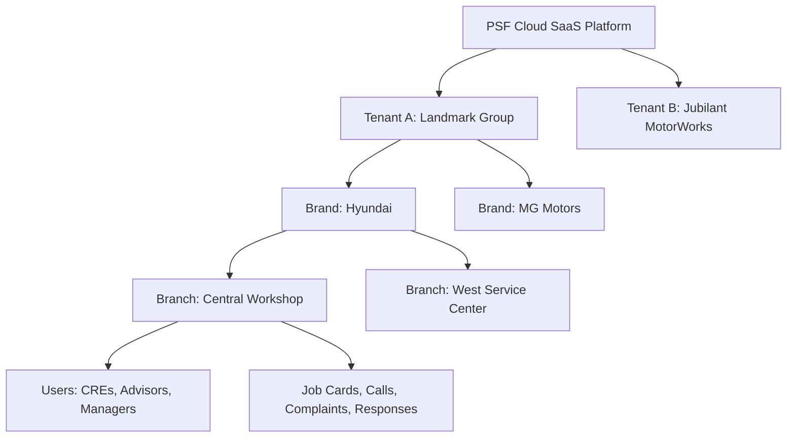
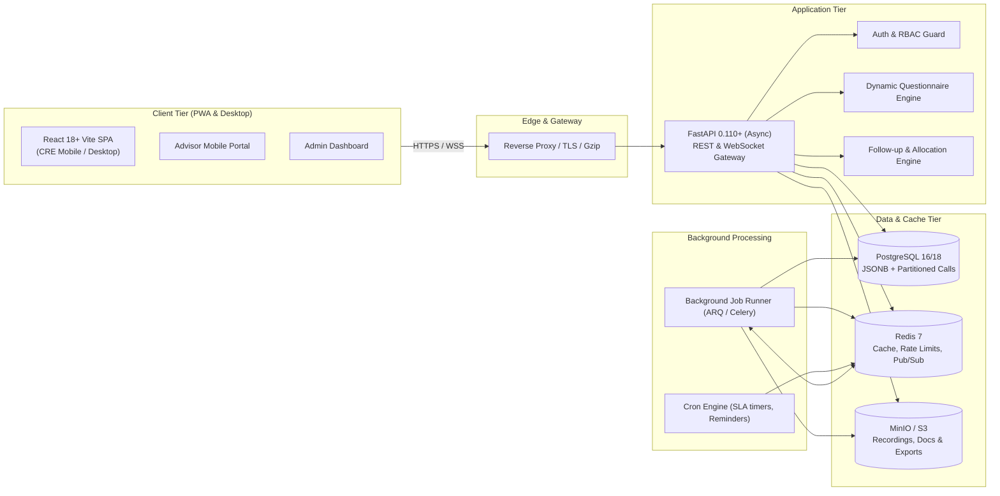
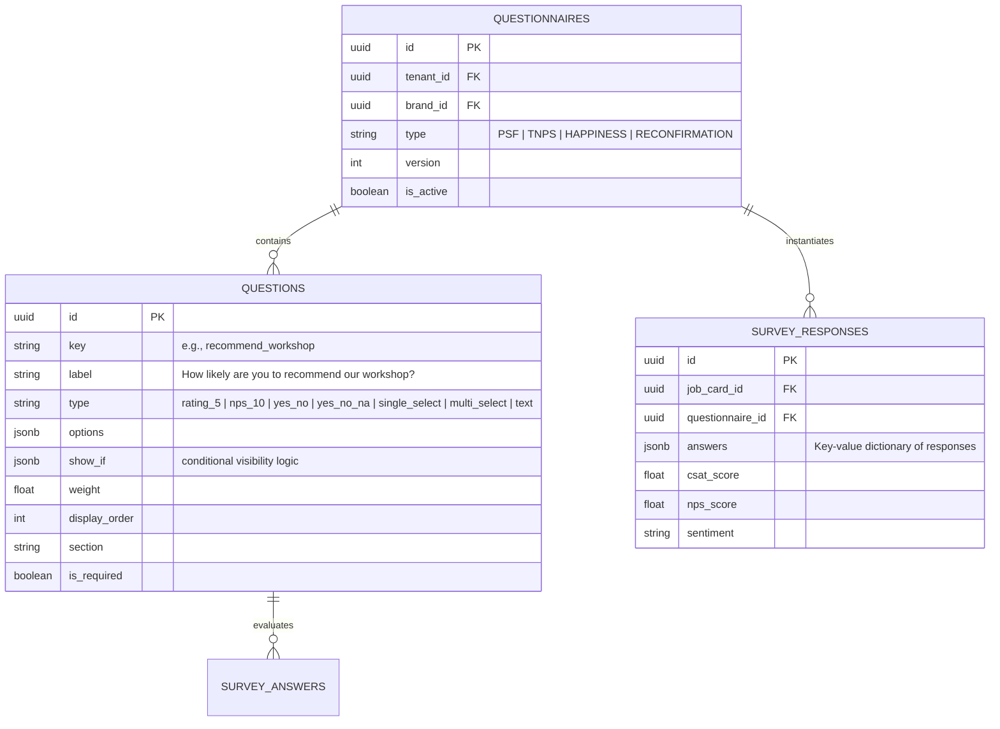
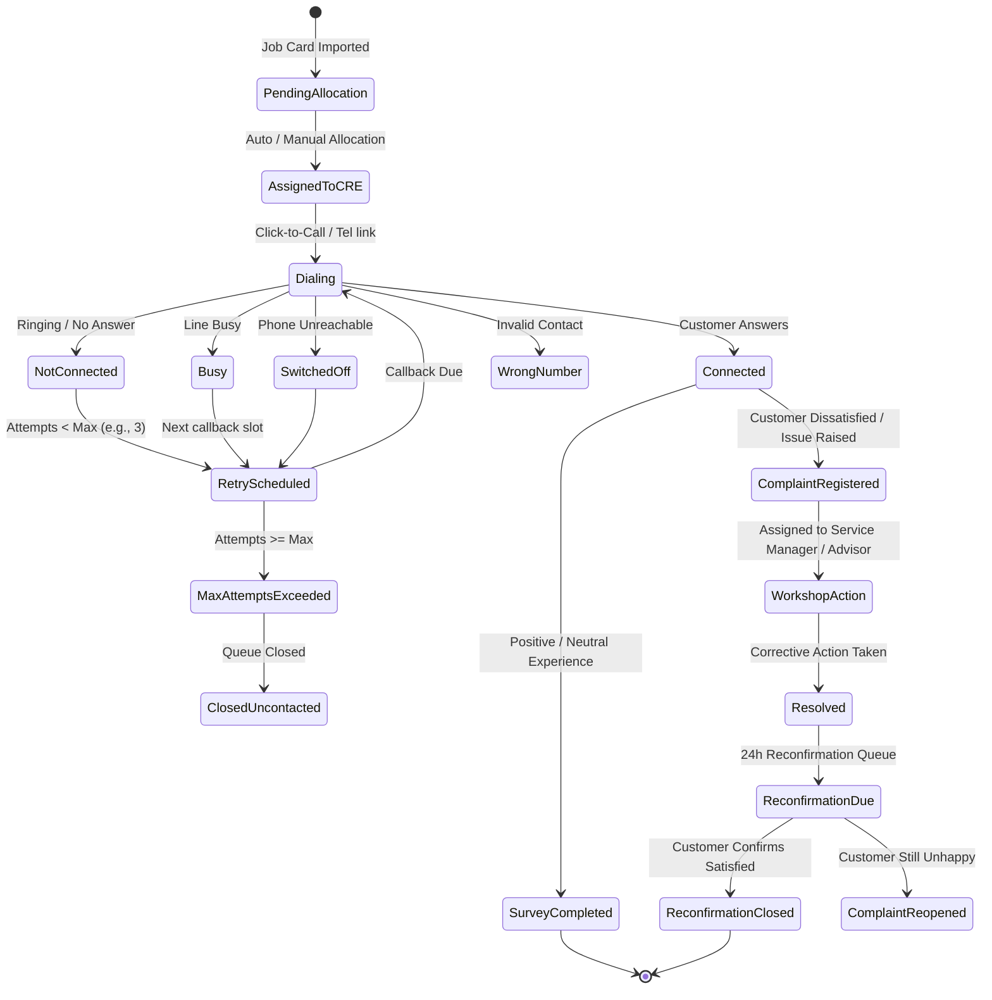
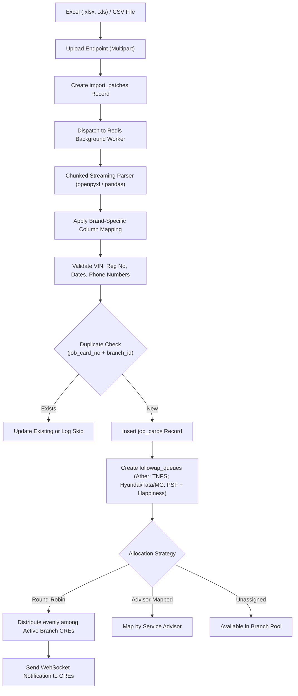

# PSF (Post Service Follow-up) SaaS Platform Architecture

## 1. Executive Summary & Domain Context

**PSF – Post Service Follow-up** is a multi-tenant, white-label Enterprise SaaS web application engineered specifically for automotive dealership networks (e.g., Hyundai, MG Motors, Ather Energy, Tata Motors, etc.). 

In the automotive service industry, the customer journey does not end when the invoice is paid and the vehicle is delivered. The **Customer Relations Executive (CRE / CRM)** team must contact the customer within 24 to 72 hours post-delivery to:
1. Confirm service quality, delivery timeliness, and advisor transparency.
2. Capture structured survey responses across brand-specific quality metrics (PSF questionnaire).
3. Compute **CSAT** (Customer Satisfaction) and **NPS** (Net Promoter Score; note: "TNPS" is the brand-specific name of the PSF follow-up program for Ather Energy).
4. Identify dissatifactions, log complaints immediately, and route them to workshop managers or service advisors.
5. Track complaint resolution through a strict SLA-driven workflow and conduct mandatory **Post-Resolution Reconfirmation calls**.
6. Provide Service Advisors with direct access to feedback assigned to them for corrective action.
7. Perform 15-day / 30-day **Happiness Calling** to ensure long-term retention.

This modern architecture replaces legacy Google AppSheet implementations with a resilient, scalable, distributed stack capable of handling millions of job cards and calls with sub-second dashboard latencies.

---

## 2. Multi-Tenancy & Data Isolation Model

The platform employs a **Shared Database, Shared Schema with Discriminator Columns & Row-Level Scoping** model, augmented by PostgreSQL Row-Level Security (RLS) policies for strict tenant separation.

### Multi-Tenancy Hierarchy
1. **Tenant (`Dealer Group`)**: Top-level billing and isolation boundary (e.g., *Apex Auto Group*).
2. **Brand (`OEM Brand`)**: Automobile manufacturers represented within the dealer group (e.g., *Hyundai*, *MG*, *Ather*). Each brand maintains its own questionnaires, DMS column mappings, and SLA policies.
3. **Branch (`Workshop / Facility`)**: Physical workshop location where repairs occur.
4. **User Scope**: Users are assigned to one or more Brands and Branches within their Tenant.

### Tenant Isolation Enforcement
- **Middleware Scoping**: Every incoming authenticated request extracts the user's `tenant_id` from the cryptographically verified JWT / Session and injects it into the request context (`request.state.tenant_id`).
- **Repository-Level Filtering**: All database queries automatically append `WHERE tenant_id = :current_tenant_id`.
- **Postgres Row-Level Security (RLS)**: Can be activated on critical operational tables (`job_cards`, `calls`, `complaints`, `survey_responses`) setting `current_setting('app.current_tenant_id')`.
- **White-Labeling**: Each tenant can configure their company name, accent colors, logo URLs, domain CNAME, and notification sender IDs in the `settings` entity.

---

## 3. High-Level System Architecture

---

## 4. RBAC & User Permission Matrix

The application enforces a granular Role-Based Access Control (RBAC) model:

| Role | Scope | Permissions | Primary Workspaces |
| :--- | :--- | :--- | :--- |
| **Super Admin** | Global (Cross-Tenant) | System config, Tenant provisioning, Global audit | Platform Operations |
| **Dealer Admin** | Tenant-wide | Tenant settings, User management, Brand/Branch config, Master questionnaires | Admin Settings, Reports |
| **Brand Manager** | Brand-specific | Brand reports, Questionnaire reviews, Brand SLA configuration | Reports, Master Data |
| **Branch Manager** | Branch-specific | Allocations, Branch complaints, CRE productivity, SLA escalations | PSF Dashboard, Complaints, Reports |
| **CRE (Caller)** | Assigned Branches / Queues | Make calls, record surveys, register complaints, schedule callbacks | Home, PSF Dashboard, Call Console, Happiness |
| **Service Advisor** | Assigned Job Cards | View assigned calls/VOC, add advisor closure remarks | Advisor Followup Portal |
| **Auditor** | Tenant / Read-only | View all records, audit logs, reports, export data (read-only) | Reports, Audit Trail |

### Attendance-Style Login Logs
To match dealership requirements, every session registers an entry in `login_logs`:
- `login_at`: exact timestamp of authentication.
- `logout_at`: timestamp of explicit logout or session expiry.
- `active_duration_seconds`: tracked active time.
- `ip_address`, `user_agent`, `device_info`: audit details to detect unauthorized station sharing.

---

## 5. Dynamic Questionnaire Engine Architecture

Legacy systems stored ~130 flat, hardcoded columns in spreadsheets for questions. This platform replaces that with a metadata-driven engine:

### Key Technical Advantages:
1. **Dynamic Schema**: Adding or modifying questions does not alter database tables or require downtime.
2. **Conditional Logic (`show_if`)**: For example, only show *"Reason for low advisor rating"* if `"advisor_rating" <= 3`.
3. **Instant Aggregation**: Responses store a raw `answers` JSONB payload alongside calculated denormalized scores (`csat_score`, `nps_score`), indexed with GIN for fast analytical slicing.

---

## 6. Call Console & Follow-up Workflow

The **Call Console** is the mission-critical workstation for CREs:

### Call Session Mechanics:
- **Timer**: Client-side elapsed timer records actual conversation length.
- **Auto-Save Draft**: TanStack Query + local session storage preserves inputs in real-time.
- **Deep Linking**: Clickable phone icons trigger `tel:` protocol or CTI telephony webhooks; WhatsApp button opens pre-filled template message in WhatsApp Web / App.
- **Contact Tracking**: Automatically increments `attempts` and sets `contacted_count`.

---

## 7. Data Ingestion & Bulk Allocation Engine

---

## 8. Real-Time Updates & Caching Architecture

- **Redis Caching**: Dashboard aggregate counters (e.g., Pending PSF, Connected, Open Complaints) are cached in Redis with a 15-minute TTL, invalidated instantly on call or complaint write operations.
- **WebSocket Gateway**: A lightweight FastAPI WebSocket endpoint streams badge counters, live notifications, and callback reminders directly to active CRE sessions.
- **TanStack Query (Client-Side)**: Optimistic mutations with automatic query cache invalidation provide a zero-lag user experience.

---

## 9. Security, Privacy & Compliance

1. **Authentication**: Signed HTTP-only cookies containing JWT tokens prevent XSS credential theft.
2. **Password Security**: Passwords hashed with `bcrypt` (work factor 12) or `argon2id`.
3. **PII Protection**: Customer mobile numbers and email addresses are masked in UI for non-privileged roles and encrypted at rest using AES-GCM-256 where compliance mandates.
4. **Audit Trail**: Every critical action (complaint resolution, user role change, record export) logs an entry to `audit_logs` capturing `user_id`, `action`, `entity`, `ip`, and before/after JSON diffs.
5. **Rate Limiting**: Redis token-bucket rate limiters guard API endpoints against brute force and denial of service.

