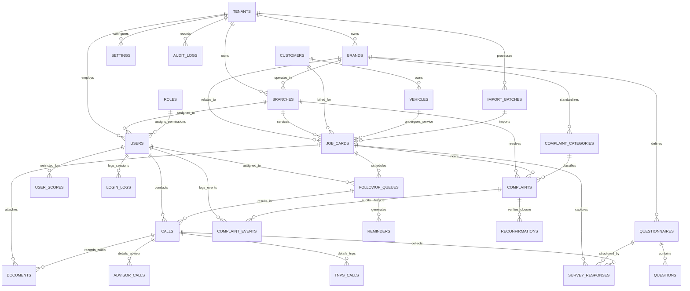

# PSF SaaS Platform Entity-Relationship (ER) Architecture

## 1. High-Level Entity Relationship Diagram (Mermaid)

---

## 2. Comprehensive Entity Data Dictionary

### 2.1 Core Multi-Tenancy & Access Control

#### `tenants`
Top-level multi-tenant container representing an automobile dealership conglomerate.
- `id` (UUIDv7, PK): Unique tenant identifier.
- `name` (VARCHAR 150, NOT NULL): Group name (e.g., "Apex Automotive Group").
- `slug` (VARCHAR 80, UNIQUE, NOT NULL): URL-friendly unique slug.
- `is_active` (BOOLEAN, DEFAULT true): Active state flag.
- `created_at` (TIMESTAMPTZ, DEFAULT now()): Timestamp.
- `updated_at` (TIMESTAMPTZ, DEFAULT now()): Timestamp.
- *Indexes*: `(slug)`, `(is_active)`.

#### `brands`
Automobile OEM brands managed by the dealer group.
- `id` (UUIDv7, PK)
- `tenant_id` (UUIDv7, FK -> tenants.id, NOT NULL)
- `name` (VARCHAR 100, NOT NULL): Brand name (e.g., "Hyundai", "MG Motors", "Ather Energy").
- `code` (VARCHAR 30, NOT NULL): Short code (e.g., "HYUN", "MG", "ATHER").
- `logo_url` (VARCHAR 500): S3 URL for brand logo badge.
- `primary_color` (VARCHAR 20): Brand theme hex code.
- `is_active` (BOOLEAN, DEFAULT true)
- `created_at` / `updated_at`
- *Indexes*: `(tenant_id, code)` UNIQUE, `(tenant_id, is_active)`.

#### `branches`
Physical dealership service workshops and customer touchpoints.
- `id` (UUIDv7, PK)
- `tenant_id` (UUIDv7, FK -> tenants.id, NOT NULL)
- `brand_id` (UUIDv7, FK -> brands.id, NOT NULL)
- `name` (VARCHAR 150, NOT NULL): Branch name (e.g., "Central Service Centre").
- `code` (VARCHAR 50, NOT NULL): DMS Branch code (e.g., "CSC-01").
- `address` (TEXT), `city` (VARCHAR 100), `state` (VARCHAR 100), `pincode` (VARCHAR 20)
- `phone` (VARCHAR 30), `email` (VARCHAR 120)
- `is_active` (BOOLEAN, DEFAULT true)
- *Indexes*: `(tenant_id, brand_id, code)` UNIQUE, `(tenant_id, is_active)`.

#### `roles`
System-wide and tenant-specific role definitions.
- `id` (UUIDv7, PK)
- `tenant_id` (UUIDv7, FK -> tenants.id, NULLABLE for global roles)
- `name` (VARCHAR 50, NOT NULL): e.g., "SUPER_ADMIN", "DEALER_ADMIN", "BRAND_MANAGER", "BRANCH_MANAGER", "CRE", "SERVICE_ADVISOR", "AUDITOR".
- `description` (TEXT)
- `permissions` (JSONB, NOT NULL): Array of granted permission strings (e.g., `["psf:read", "psf:call", "complaints:manage"]`).
- `is_system` (BOOLEAN, DEFAULT false): Prevent deletion of system roles.

#### `users`
User accounts for dealership personnel.
- `id` (UUIDv7, PK)
- `tenant_id` (UUIDv7, FK -> tenants.id, NOT NULL)
- `role_id` (UUIDv7, FK -> roles.id, NOT NULL)
- `email` (VARCHAR 150, NOT NULL)
- `hashed_password` (VARCHAR 255, NOT NULL)
- `full_name` (VARCHAR 120, NOT NULL)
- `phone` (VARCHAR 30)
- `employee_id` (VARCHAR 50)
- `is_active` (BOOLEAN, DEFAULT true)
- `avatar_url` (VARCHAR 500)
- `last_login_at` (TIMESTAMPTZ)
- *Indexes*: `(tenant_id, email)` UNIQUE, `(tenant_id, role_id)`, `(tenant_id, is_active)`.

#### `user_scopes`
Granular mapping restricting a user's operational visibility to specific brands and branches.
- `id` (UUIDv7, PK)
- `user_id` (UUIDv7, FK -> users.id, NOT NULL)
- `brand_id` (UUIDv7, FK -> brands.id, NULLABLE - if null, all brands permitted)
- `branch_id` (UUIDv7, FK -> branches.id, NULLABLE - if null, all branches under brand permitted)
- *Indexes*: `(user_id, brand_id, branch_id)` UNIQUE.

#### `login_logs`
Attendance-style login auditing.
- `id` (UUIDv7, PK)
- `tenant_id` (UUIDv7, FK -> tenants.id, NOT NULL)
- `user_id` (UUIDv7, FK -> users.id, NOT NULL)
- `login_at` (TIMESTAMPTZ, NOT NULL, DEFAULT now())
- `logout_at` (TIMESTAMPTZ)
- `duration_seconds` (INTEGER)
- `ip_address` (VARCHAR 64)
- `user_agent` (VARCHAR 500)
- `device_info` (VARCHAR 200)
- `status` (VARCHAR 30, DEFAULT 'SUCCESS'): e.g., 'SUCCESS', 'FAILED', 'LOGGED_OUT', 'TIMEOUT'
- *Indexes*: `(tenant_id, user_id, login_at DESC)`, `(tenant_id, login_at DESC)`.

---

### 2.2 Customer & Vehicle Master

#### `customers`
- `id` (UUIDv7, PK)
- `tenant_id` (UUIDv7, FK -> tenants.id, NOT NULL)
- `name` (VARCHAR 150, NOT NULL)
- `phone` (VARCHAR 30, NOT NULL)
- `alt_phone` (VARCHAR 30)
- `email` (VARCHAR 150)
- `address` (TEXT), `city` (VARCHAR 100)
- `do_not_disturb` (BOOLEAN, DEFAULT false)
- *Indexes*: `(tenant_id, phone)`, `(tenant_id, name)`.

#### `vehicles`
- `id` (UUIDv7, PK)
- `tenant_id` (UUIDv7, FK -> tenants.id, NOT NULL)
- `brand_id` (UUIDv7, FK -> brands.id, NOT NULL)
- `customer_id` (UUIDv7, FK -> customers.id, NOT NULL)
- `reg_no` (VARCHAR 30, NOT NULL): Vehicle registration number (e.g., "DL01AB1234").
- `vin` (VARCHAR 50): Vehicle Identification / Chassis Number.
- `model` (VARCHAR 100, NOT NULL): e.g., "Creta SX(O)", "ZS EV", "450X".
- `variant` (VARCHAR 100), `fuel_type` (VARCHAR 30), `delivery_date` (DATE)
- *Indexes*: `(tenant_id, reg_no)`, `(tenant_id, vin)`, `(customer_id)`.

---

### 2.3 Job Cards & Ingestion

#### `import_batches`
Logs bulk DMS data imports.
- `id` (UUIDv7, PK)
- `tenant_id` (UUIDv7, FK -> tenants.id, NOT NULL)
- `uploaded_by` (UUIDv7, FK -> users.id, NOT NULL)
- `brand_id` (UUIDv7, FK -> brands.id, NOT NULL)
- `branch_id` (UUIDv7, FK -> branches.id)
- `file_name` (VARCHAR 255, NOT NULL)
- `file_url` (VARCHAR 500)
- `total_rows` (INTEGER, DEFAULT 0)
- `processed_rows` (INTEGER, DEFAULT 0)
- `success_rows` (INTEGER, DEFAULT 0)
- `error_rows` (INTEGER, DEFAULT 0)
- `error_log` (JSONB)
- `status` (VARCHAR 30, DEFAULT 'PENDING'): 'PENDING', 'PROCESSING', 'COMPLETED', 'FAILED'
- `created_at` / `updated_at`
- *Indexes*: `(tenant_id, status, created_at DESC)`.

#### `job_cards`
Primary transactional record representing a completed workshop service invoice.
- `id` (UUIDv7, PK)
- `tenant_id` (UUIDv7, FK -> tenants.id, NOT NULL)
- `brand_id` (UUIDv7, FK -> brands.id, NOT NULL)
- `branch_id` (UUIDv7, FK -> branches.id, NOT NULL)
- `customer_id` (UUIDv7, FK -> customers.id, NOT NULL)
- `vehicle_id` (UUIDv7, FK -> vehicles.id, NOT NULL)
- `import_batch_id` (UUIDv7, FK -> import_batches.id)
- `job_card_no` (VARCHAR 60, NOT NULL): Dealership DMS Job Card Number.
- `job_card_date` (DATE, NOT NULL): Service completion date.
- `service_advisor_name` (VARCHAR 120)
- `service_advisor_id` (UUIDv7, FK -> users.id)
- `technician_name` (VARCHAR 120)
- `service_type` (VARCHAR 80): e.g., "Paid Service", "Free Service 1", "Running Repair", "Accidental Bodywork".
- `total_amount` (NUMERIC(12, 2), DEFAULT 0.00)
- `odometer_reading` (INTEGER)
- `promised_delivery_time` (TIMESTAMPTZ)
- `actual_delivery_time` (TIMESTAMPTZ)
- `uploaded_by` (UUIDv7, FK -> users.id)
- `created_at` / `updated_at`
- *Indexes*: 
  - `(tenant_id, branch_id, job_card_no)` UNIQUE
  - `(tenant_id, branch_id, job_card_date DESC)`
  - `(tenant_id, service_advisor_id)`
  - `(tenant_id, customer_id)`

---

### 2.4 Follow-Up & Call Execution

#### `followup_queues`
Actionable calling queues generated for each job card.
- `id` (UUIDv7, PK)
- `tenant_id` (UUIDv7, FK -> tenants.id, NOT NULL)
- `job_card_id` (UUIDv7, FK -> job_cards.id, NOT NULL)
- `queue_type` (VARCHAR 40, NOT NULL): 'PSF' | 'TNPS' | 'HAPPINESS' | 'RECONFIRMATION' | 'ADVISOR'
- `status` (VARCHAR 40, NOT NULL, DEFAULT 'PENDING'): 'PENDING', 'IN_PROGRESS', 'CONTACTED', 'NOT_CONTACTED', 'CALLBACK_REQUESTED', 'CLOSED_MAX_ATTEMPTS', 'CANCELLED'
- `assigned_to` (UUIDv7, FK -> users.id)
- `due_at` (TIMESTAMPTZ, NOT NULL)
- `attempts` (INTEGER, DEFAULT 0)
- `contacted_count` (INTEGER, DEFAULT 0)
- `last_attempt_at` (TIMESTAMPTZ)
- `next_followup_at` (TIMESTAMPTZ)
- `completed_at` (TIMESTAMPTZ)
- *Indexes*:
  - Composite Index: `(tenant_id, queue_type, status, due_at)`
  - Composite Index: `(tenant_id, assigned_to, status, due_at)`
  - `(job_card_id)`

#### `calls`
Granular log of every individual call attempt.
- `id` (UUIDv7, PK)
- `tenant_id` (UUIDv7, FK -> tenants.id, NOT NULL)
- `followup_queue_id` (UUIDv7, FK -> followup_queues.id, NOT NULL)
- `job_card_id` (UUIDv7, FK -> job_cards.id, NOT NULL)
- `called_by` (UUIDv7, FK -> users.id, NOT NULL)
- `called_at` (TIMESTAMPTZ, NOT NULL, DEFAULT now())
- `duration_seconds` (INTEGER, DEFAULT 0)
- `phone_dialed` (VARCHAR 30, NOT NULL)
- `call_status` (VARCHAR 50, NOT NULL): 'Connected', 'Not Connected', 'Busy', 'Switched Off', 'Wrong Number', 'Ringing No Answer', 'Call Disconnected', 'Callback Requested'
- `case_status` (VARCHAR 50, NOT NULL): 'Satisfied', 'Dissatisfied', 'Complaint Registered', 'In Discussion', 'Not Responded', 'Repeat Followup'
- `voc` (TEXT): Voice of Customer notes verbatim.
- `alt_contact_used` (BOOLEAN, DEFAULT false)
- `recording_url` (VARCHAR 500)
- *Indexes*:
  - Composite Index: `(tenant_id, called_at DESC)`
  - Composite Index: `(tenant_id, called_by, called_at DESC)`
  - `(followup_queue_id)`

#### `survey_responses`
Questionnaire responses captured during successful calls.
- `id` (UUIDv7, PK)
- `tenant_id` (UUIDv7, FK -> tenants.id, NOT NULL)
- `call_id` (UUIDv7, FK -> calls.id, NOT NULL)
- `job_card_id` (UUIDv7, FK -> job_cards.id, NOT NULL)
- `questionnaire_id` (UUIDv7, FK -> questionnaires.id, NOT NULL)
- `answers` (JSONB, NOT NULL): `{ "recommend_workshop": 10, "charges_explained": true, ... }`
- `csat_score` (NUMERIC(5, 2)): Normalized 0 - 100 CSAT percentage.
- `nps_score` (SMALLINT): Net Promoter score rating (0–10).
- `nps_category` (VARCHAR 20): 'PROMOTER' (9-10), 'PASSIVE' (7-8), 'DETRACTOR' (0-6).
- *Indexes*:
  - GIN Index: `USING GIN (answers)`
  - `(tenant_id, nps_category)`
  - `(call_id)`

---

### 2.5 Dynamic Questionnaire Master

#### `questionnaires`
- `id` (UUIDv7, PK)
- `tenant_id` (UUIDv7, FK -> tenants.id, NOT NULL)
- `brand_id` (UUIDv7, FK -> brands.id, NOT NULL)
- `type` (VARCHAR 40, NOT NULL): 'PSF', 'TNPS', 'HAPPINESS', 'RECONFIRMATION'
- `title` (VARCHAR 150, NOT NULL)
- `version` (INTEGER, NOT NULL, DEFAULT 1)
- `is_active` (BOOLEAN, DEFAULT true)
- *Indexes*: `(tenant_id, brand_id, type, version)` UNIQUE.

#### `questions`
- `id` (UUIDv7, PK)
- `questionnaire_id` (UUIDv7, FK -> questionnaires.id, NOT NULL)
- `key` (VARCHAR 80, NOT NULL): Unique slug within questionnaire (e.g. `car_cleanliness`).
- `label` (TEXT, NOT NULL): Form question label shown to CRE.
- `type` (VARCHAR 40, NOT NULL): 'rating_5', 'nps_10', 'yes_no', 'yes_no_na', 'single_select', 'multi_select', 'text', 'number'.
- `section` (VARCHAR 80, DEFAULT 'General'): Logical UI section group.
- `options` (JSONB): Predefined select choices if applicable.
- `show_if` (JSONB): Conditional visibility rule (e.g. `{"field": "overall_exp", "operator": "<=", "value": 3}`).
- `weight` (NUMERIC(4, 2), DEFAULT 1.0)
- `display_order` (INTEGER, NOT NULL, DEFAULT 0)
- `is_required` (BOOLEAN, DEFAULT false)
- *Indexes*: `(questionnaire_id, display_order)`.

---

### 2.6 Complaint & Resolution Lifecycle

#### `complaint_categories`
Configurable taxonomy per tenant and brand.
- `id` (UUIDv7, PK)
- `tenant_id` (UUIDv7, FK -> tenants.id, NOT NULL)
- `brand_id` (UUIDv7, FK -> brands.id)
- `name` (VARCHAR 100, NOT NULL): e.g. "Workmanship & Repair Quality", "Billing Discrepancy", "Delivery Delay", "Staff Behavior".
- `default_sla_hours` (INTEGER, DEFAULT 24)
- `severity_level` (VARCHAR 30, DEFAULT 'MEDIUM'): 'LOW', 'MEDIUM', 'HIGH', 'CRITICAL'
- `is_active` (BOOLEAN, DEFAULT true)

#### `complaints`
- `id` (UUIDv7, PK)
- `tenant_id` (UUIDv7, FK -> tenants.id, NOT NULL)
- `branch_id` (UUIDv7, FK -> branches.id, NOT NULL)
- `job_card_id` (UUIDv7, FK -> job_cards.id, NOT NULL)
- `call_id` (UUIDv7, FK -> calls.id)
- `category_id` (UUIDv7, FK -> complaint_categories.id, NOT NULL)
- `complaint_no` (VARCHAR 50, NOT NULL): Human-readable ticket number (e.g. "CMP-2026-0042").
- `severity` (VARCHAR 30, NOT NULL, DEFAULT 'MEDIUM')
- `status` (VARCHAR 40, NOT NULL, DEFAULT 'OPEN'): 'OPEN', 'ASSIGNED', 'IN_PROGRESS', 'RESOLVED', 'RECONFIRMATION_PENDING', 'CLOSED', 'REOPENED'
- `description` (TEXT, NOT NULL)
- `assigned_to` (UUIDv7, FK -> users.id)
- `sla_due_at` (TIMESTAMPTZ, NOT NULL)
- `is_sla_breached` (BOOLEAN, DEFAULT false)
- `resolution_remarks` (TEXT)
- `resolved_by` (UUIDv7, FK -> users.id)
- `resolved_at` (TIMESTAMPTZ)
- `closed_by` (UUIDv7, FK -> users.id)
- `closed_at` (TIMESTAMPTZ)
- *Indexes*:
  - Composite: `(tenant_id, branch_id, status, sla_due_at)`
  - Composite: `(tenant_id, assigned_to, status)`
  - `(complaint_no)` UNIQUE

#### `complaint_events`
Immutable audit timeline tracking transitions and comments.
- `id` (UUIDv7, PK)
- `complaint_id` (UUIDv7, FK -> complaints.id, NOT NULL)
- `performed_by` (UUIDv7, FK -> users.id, NOT NULL)
- `event_type` (VARCHAR 50, NOT NULL): 'CREATED', 'ASSIGNED', 'STATUS_CHANGE', 'COMMENT_ADDED', 'SLA_ESCALATED', 'RESOLVED', 'REOPENED', 'CLOSED'
- `from_status` (VARCHAR 40)
- `to_status` (VARCHAR 40)
- `remarks` (TEXT)
- `created_at` (TIMESTAMPTZ, DEFAULT now())

#### `reconfirmations`
Post-resolution check calls to ensure customer is truly satisfied.
- `id` (UUIDv7, PK)
- `tenant_id` (UUIDv7, FK -> tenants.id, NOT NULL)
- `complaint_id` (UUIDv7, FK -> complaints.id, NOT NULL)
- `conducted_by` (UUIDv7, FK -> users.id, NOT NULL)
- `reconfirmation_date` (TIMESTAMPTZ, NOT NULL, DEFAULT now())
- `status` (VARCHAR 40, NOT NULL): 'SATISFIED_CLOSED', 'UNSATISFIED_REOPENED'
- `call_status` (VARCHAR 50, NOT NULL)
- `customer_feedback` (TEXT)
- `closure_verified` (BOOLEAN, DEFAULT false)

---

### 2.7 Supporting Operational Entities

#### `reminders`
Scheduled callbacks and follow-up notifications.
- `id` (UUIDv7, PK)
- `tenant_id` (UUIDv7, FK -> tenants.id, NOT NULL)
- `followup_queue_id` (UUIDv7, FK -> followup_queues.id, NOT NULL)
- `assigned_to` (UUIDv7, FK -> users.id, NOT NULL)
- `remind_at` (TIMESTAMPTZ, NOT NULL)
- `note` (TEXT)
- `is_acknowledged` (BOOLEAN, DEFAULT false)
- *Indexes*: `(tenant_id, assigned_to, is_acknowledged, remind_at)`.

#### `documents`
Uploaded attachments (complaint evidence, gate passes, invoices, call recordings).
- `id` (UUIDv7, PK)
- `tenant_id` (UUIDv7, FK -> tenants.id, NOT NULL)
- `entity_type` (VARCHAR 40, NOT NULL): 'COMPLAINT', 'JOB_CARD', 'CALL', 'RECONFIRMATION'
- `entity_id` (UUIDv7, NOT NULL)
- `file_name` (VARCHAR 255, NOT NULL)
- `file_url` (VARCHAR 500, NOT NULL)
- `mime_type` (VARCHAR 100)
- `file_size_bytes` (BIGINT)
- `uploaded_by` (UUIDv7, FK -> users.id)
- `created_at` (TIMESTAMPTZ, DEFAULT now())

#### `audit_logs`
System-wide security and compliance audit logs.
- `id` (UUIDv7, PK)
- `tenant_id` (UUIDv7, FK -> tenants.id, NOT NULL)
- `user_id` (UUIDv7, FK -> users.id)
- `action` (VARCHAR 80, NOT NULL): e.g. 'USER_LOGIN', 'JOB_CARD_IMPORT', 'EXPORT_REPORT', 'COMPLAINT_STATUS_UPDATE'
- `entity_type` (VARCHAR 80)
- `entity_id` (VARCHAR 100)
- `old_values` (JSONB)
- `new_values` (JSONB)
- `ip_address` (VARCHAR 64)
- `user_agent` (VARCHAR 500)
- `created_at` (TIMESTAMPTZ, DEFAULT now())

#### `settings`
Tenant-level configuration parameters.
- `id` (UUIDv7, PK)
- `tenant_id` (UUIDv7, FK -> tenants.id, NOT NULL)
- `config_key` (VARCHAR 80, NOT NULL)
- `config_value` (JSONB, NOT NULL)
- *Indexes*: `(tenant_id, config_key)` UNIQUE.

---

## 3. High-Volume Partitioning & Indexing Plan

### Partitioning Plan:
For enterprise dealership networks processing 500,000+ job cards per year:
1. **`calls` table**: Range-partitioned by month on `called_at` (e.g., `calls_2026_01`, `calls_2026_02`).
2. **`survey_responses` table**: Range-partitioned by month corresponding to `created_at`.
3. **`audit_logs` table**: Partitioned quarterly with automatic retention policy dropping logs older than 2 years or archiving to cold S3 storage.

### Composite Performance Indexes:
- `followup_queues(tenant_id, queue_type, status, due_at)`: Powers instantaneous dashboard widget lookups and queue filtering.
- `job_cards(tenant_id, branch_id, job_card_date DESC)`: Accelerates DMS imports and daily job card views.
- `complaints(tenant_id, branch_id, status, sla_due_at)`: Eliminates table scans for SLA monitoring cron jobs.
- `survey_responses USING GIN(answers)`: Enables arbitrary JSON question querying without table schema migrations.
